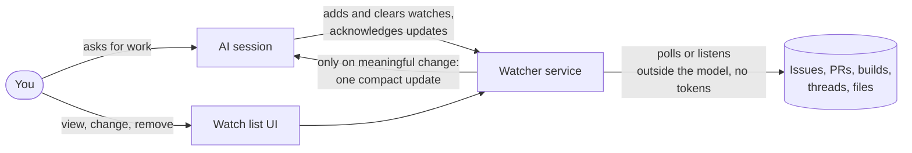

# Session source watcher

**Your AI session keeps an eye on the work it is waiting for, and spends tokens
only when something actually happens.**

Real work waits on other people and other systems: a reviewer, a CI run, a
colleague in a chat thread, the reporter of an issue. Today an AI session either
forgets about them the moment the conversation goes quiet, or spends model turns
polling things that have not changed.

Session source watcher gives every conversation a small, visible watch list
that the agent keeps for you. When the agent opens a pull request, starts a
build or asks someone a question, it adds a watch on its own, and removes it
again when the work is done. You do not have to ask. A local service checks
those resources outside the model, by polling them or listening for events,
notices meaningful changes, and only then hands the owning session one compact,
durable update. The session
decides what to do, with the same permissions it already has. You can see,
change, pause and remove every watch at any time.

## Waiting costs no tokens

Watching happens entirely outside the model. A small local service polls the
resources with cheap conditional requests, or listens for events where a
provider or the file system offers them. Checking a pull request a hundred
times while nobody touches it costs a hundred tiny HTTP requests and zero
model tokens.

| | Agent polls by itself | Session source watcher |
| --- | --- | --- |
| Who checks | The model, in a turn | A local service, outside the model |
| Cost per unchanged check | A model turn: prompt, context and tool output tokens | One conditional request, no tokens |
| Cost while nothing happens for hours | Grows with every check | Zero tokens |
| When tokens are spent | Every check | Only when a meaningful change is delivered |
| What the model reads | Full tool output each time | A compact summary of what changed |

The model wakes up only for an update worth reading, and that update is already
reduced to the changes that matter.

**Status:** Proposed. This repository contains the architecture and a
TypeScript build scaffold. No watcher service, source adapters, MCP server or
harness integrations are implemented yet.

## What it feels like

```text
You    Open a PR for the fix and address review feedback.

Agent  Opened example/project#42. I'm watching its reviews and checks until
       it merges.                                     [watch w-7 added by agent]

       ... two hours pass: the watcher checks every few minutes outside the
           model; zero tokens are spent ...

Watch  w-7 · example/project#42 · 2 changes · coverage complete
       1. Review: changes requested by @reviewer on src/cache.ts:88
          "The cache key ignores the locale."
       2. Check unit-tests: passed -> failed

Agent  The reviewer is right, and the failing test is the same bug: the key
       omits the locale. Pushed a fix with a regression test and replied in
       the review thread. Still watching.                   [acknowledged]

       ... the agent's own reply and push are recognised and not echoed back ...

Watch  w-7 · example/project#42 merged by @maintainer.

Agent  Merged. Nothing left to follow, so I stopped watching it.
                                                       [watch w-7 completed]
```

Nobody asked for a watch: the agent added one because it was now waiting on a
review, and cleared it when the pull request merged. The update arrived in the
session that opened the pull request, with its history and context. The
model ran only when there was something to react to. The watcher did not decide to push code; the user's
request did.

## What you can watch

| Resource | Typical changes | Useful for |
| --- | --- | --- |
| Pull request | reviews, comments, checks, state | Following a change through review and merge |
| Build or deployment run | stage results, final status | Waiting for a long pipeline without polling |
| Issue | comments, labels, state | Waiting for a reporter's answer |
| Chat thread | new replies | A question asked to a colleague |
| Local file or log | appended lines, content changes | A long-running local job |
| Saved query | new matching items | Triage of newly filed issues, without auto-subscribing to each |

## How it works



1. **Watch.** The agent adds a watch whenever it starts or waits on
   something: a pull request it opened, a build it triggered, a question it
   asked. You can add watches too. Each watch states the changes that matter
   and when to stop.
2. **Baseline.** The watcher records the current state, so existing content
   does not trigger a flood of updates.
3. **Wait without tokens.** The watcher polls with conditional requests and
   cursors, or listens for events, entirely outside the model. Unchanged
   checks only update freshness and never start a model turn.
4. **Deliver.** Meaningful changes are coalesced into one update for the owning
   session, at a turn boundary, with exact event IDs.
5. **Assess and acknowledge.** The session interprets the update under its
   existing permissions and acknowledges it. Unacknowledged work is kept, not
   lost.
6. **Clean up.** A watch ends by itself when its resource reaches a final
   state, such as merged, closed or finished, or when it expires. The agent
   also removes watches it no longer needs.

## Principles

- **Automatic, but visible.** The agent manages watches for the work it is
  waiting on, without being told. Every watch is a deliberate, visible
  registration; merely reading or mentioning a resource does not create one.
- **You stay in control.** You see every watch, who added it and why, and can
  change, pause or remove it. A watch you removed is not re-added behind your
  back.
- **Self-cleaning.** Watches complete on final states, expire, and are removed
  by the agent when the task is done.
- **Session-owned.** Each watch belongs to one conversation; you and the agent
  share one list.
- **Tokens only for changes.** Polling and listening run outside the model;
  no model turn without a meaningful change.
- **Honest.** Failed or partial reads are shown as coverage gaps, never as
  "nothing changed".
- **Durable.** Changes survive restarts, sleep and disconnected sessions.
- **Evidence, not authority.** Incoming content is untrusted data and grants no
  permission to act.
- **Local-first and harness-neutral.** Private local storage, no required
  hosted service, thin adapters per AI harness.

## Learn more

- [Session interaction](docs/session-interaction.md): the conversation
  contract, tools, update format and acknowledgments.
- [Architecture](docs/architecture.md): components, data model, change
  detection, delivery guarantees and security.
- [Prior art](docs/prior-art.md): related public projects and protocols.

## Development

Use Node.js 22.13 or later and npm.

```sh
npm ci
npm run typecheck
npm run build
```

The empty `src/index.ts` establishes the build entrypoint. JavaScript,
declarations and source maps are emitted to `dist/`. There is no runnable
service or test suite yet. npm package publication is disabled.

## Contributing

See [CONTRIBUTING.md](CONTRIBUTING.md). Do not submit credentials, private source
content or real session data in issues, fixtures, logs or examples.

## License

[Apache License 2.0](LICENSE).
