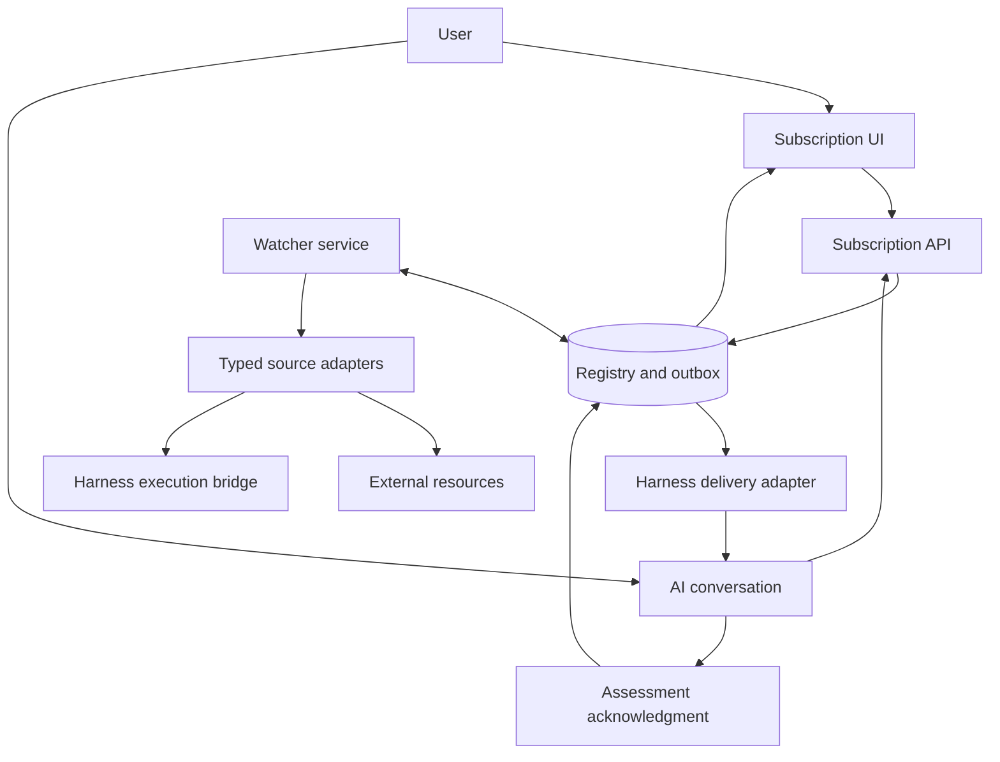

# Session source watcher architecture

**Status:** Proposed. The repository is a development scaffold, not a working
watcher service.

## Purpose

Keep an AI conversation informed about explicitly selected resources without
running a model on every poll. Each session owns subscriptions that both the
agent and user can inspect and manage. A shared service collects evidence,
detects changes and queues delivery. The session interprets changes under its
existing permissions.

This is not a general workflow engine or an autonomous remediation system.
Mentioning or reading a resource does not automatically subscribe to it.

## Components



| Component | Responsibility |
| --- | --- |
| Core | Subscription lifecycle, checkpoints, change detection and delivery state |
| Storage | Private local registry, inbox/outbox and evidence references |
| Service | Scheduling, bounded reads, coalescing and recovery |
| Source adapters | Resource identity, supported reads, versions and coverage |
| API/MCP interface | Subscription management and pending-change retrieval |
| Harness adapters | Session binding, authenticated tool execution and conversation delivery |
| UI | Shared registry view, with embedded or local-web presentation |

Start with one TypeScript package and separated modules, not many independently
released packages. Only harness integration code depends on a harness SDK.

## Implementation language

Use TypeScript on Node.js for the core and service. The UI uses HTML/CSS and
compiled TypeScript. A harness requiring a JavaScript extension entrypoint can
load compiled modules from a thin wrapper.

Validate external API requests, persisted records, bridge messages and provider
responses at runtime. Static types do not validate external data.

## Sources and subscriptions

A source is a typed canonical locator, such as `github.pull_request`,
`issue_tracker.issue`, `chat.thread`, `build.run` or `file`.

A subscription joins one source to a provider-qualified session identity and
contains selected change categories, cadence, explicit expiry, revision,
registration origin and authorization context.

```json
{
  "source": {
    "type": "github.pull_request",
    "url": "https://github.com/example/project/pull/42"
  },
  "changes": ["reviews", "checks", "state"],
  "policy": {
    "pollSeconds": 300,
    "expiresAt": "2027-01-01T18:00:00Z"
  },
  "expectedSessionRevision": 12
}
```

The API derives the owner from an authenticated session binding. Credentials and
internal checkpoints are not registration fields.

Multiple sessions may subscribe to the same resource. Share collection only
when provider identity, account, access scope, connector binding and read
requirements are compatible. Evidence must never cross account boundaries
merely because two URLs match.

Initial registration baselines existing content by default. Initial assessment
of that content requires an explicit request.

Discovery queries can be sources. Their results do not automatically become
individual resource subscriptions.

## Session API and user controls

Expose list, add, update, remove, pause, resume and assessment-acknowledgment
operations. The agent and UI use the same application layer.

Writes require expected revisions. Stale updates return current state rather
than overwriting user changes. Removal creates a tombstone and invalidates
undelivered events for that subscription generation. A removed source must not
be silently re-added by an agent or periodic refresh.

The UI shows source links, selected changes, lifecycle status, last attempt,
last complete coverage, last content change, pending assessment and errors.
Opening or closing a panel does not start or stop monitoring.

Pause, expiry and removal suppress collection and unadmitted delivery for that
subscription. They do not delete external resources, cancel admitted work or
affect other sessions' subscriptions.

## Collection and delivery

1. Select due subscriptions under a single-owner lease.
2. Execute compatible reads with bounded concurrency, pagination and deadlines.
3. Validate responses and record complete or partial coverage.
4. Commit observations and pending changes atomically.
5. Coalesce meaningful changes into a bounded packet for the owning session.
6. Recheck subscription generation, expiry and destination before admission.
7. Acknowledge exact event IDs after successful assessment/publication.

Collected, delivered and assessed checkpoints are distinct. A successful read
does not mean assessment, and an admitted message does not mean completion.

Complete unchanged checks update freshness without a model turn. Failed or
incomplete reads preserve the last complete checkpoint and expose a coverage
gap. Verified partial evidence can be retained, but cannot certify unchanged
state.

Allow one outstanding watcher assessment per session; accumulate later changes
for a subsequent packet. Coalescing must retain distinct messages, reviews and
decision-relevant transitions, not merely the latest resource snapshot.

## Reliability and lifecycle

Use private SQLite storage and a transactional outbox with stable event IDs.
Do not promise exactly-once execution across the service and conversation
runtime. Recipients deduplicate events; ambiguous admission requires
reconciliation, not blind retry.

Publication should use event IDs as idempotency keys to handle a crash between
publication and acknowledgment.

Busy or disconnected sessions retain bounded pending work. Archived sessions
suspend collection/delivery until explicitly resumed. Unknown availability is
not proof of a reachable session.

After restart or sleep, perform bounded catch-up within actual provider
retention. Unfillable gaps remain visible. Retention limits must not silently
discard pending work or advance a checkpoint past lost evidence.

The service is supervised independently of UI panels. A running service does
not imply that disconnected harness-native tools are available.

## Harness portability

Each adapter declares its capabilities: native-tool execution, availability
inspection, conversation admission, receipt reconciliation, context updates and
embedded UI. Unsupported capabilities remain explicit.

The portable MCP interface supplies subscription management and pending-change
retrieval. MCP resource notifications do not by themselves guarantee model
wakeups, persisted subscriptions or exact-session delivery.

A limited harness can retrieve changes on its next turn and use a local web
dashboard or list tool instead of a canvas. Independently authenticated
provider/CLI adapters may collect while conversations are disconnected.

An integration spike must verify a harness's publicly supported execution and
delivery contracts before implementation depends on them. Experimental APIs
are capability-gated and labelled; private APIs are not a portability contract.

## Security

Use existing credential stores or explicitly authorized provider connections.
Never include secrets in manifests or evidence. Protect local IPC and verify
session/host/account bindings; localhost is not authentication.

Adapters accept typed, validated locators and allowlisted reads, not arbitrary
shell commands or executable subscription definitions.

Source content is untrusted evidence. Incoming changes do not grant permission
to post messages, modify resources, merge code, remediate systems or create
other sessions.

Keep examples synthetic and evidence outside repositories.

## First implementation gate

Prove one public pull-request subscription through detection, exact-session
admission and assessment acknowledgment. Exercise duplicate delivery,
disconnect/reconnect, restart after admission, incomplete reads, and concurrent
pause/remove.

Then add a second harness to test portability before investing in many source
adapters. Avoid a distributed broker or general workflow language unless
requirements demonstrate a need.
