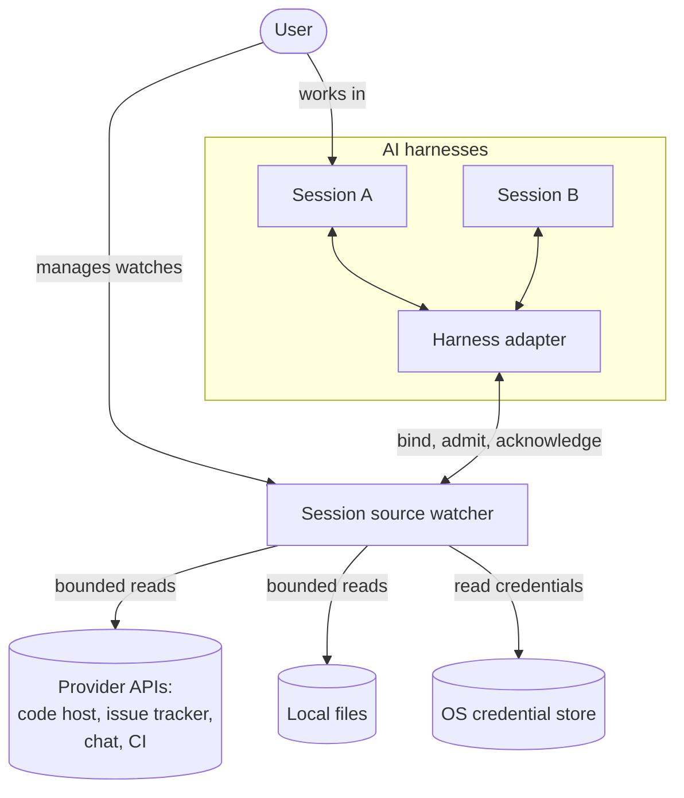
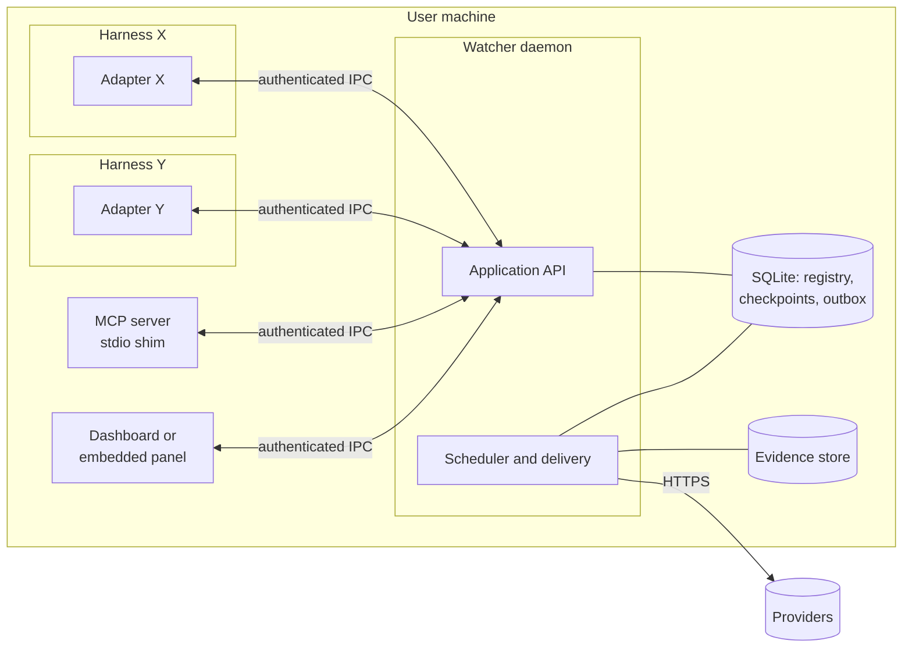
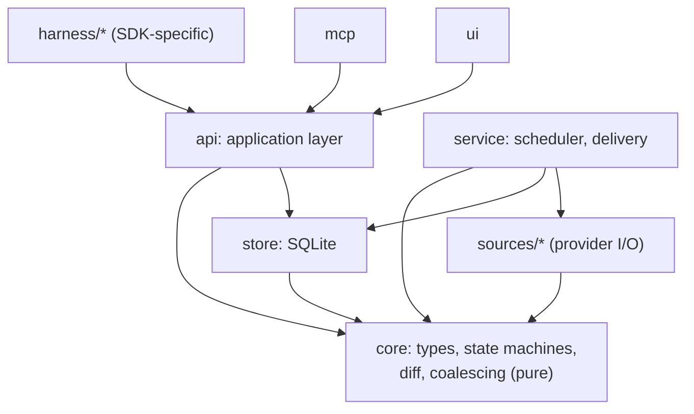
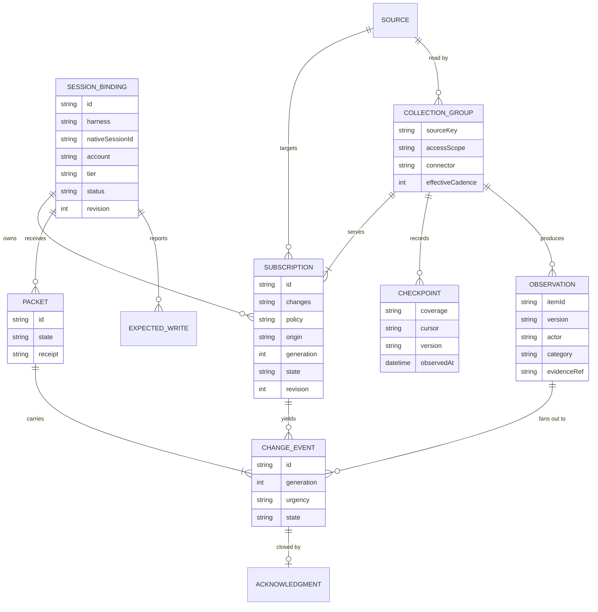
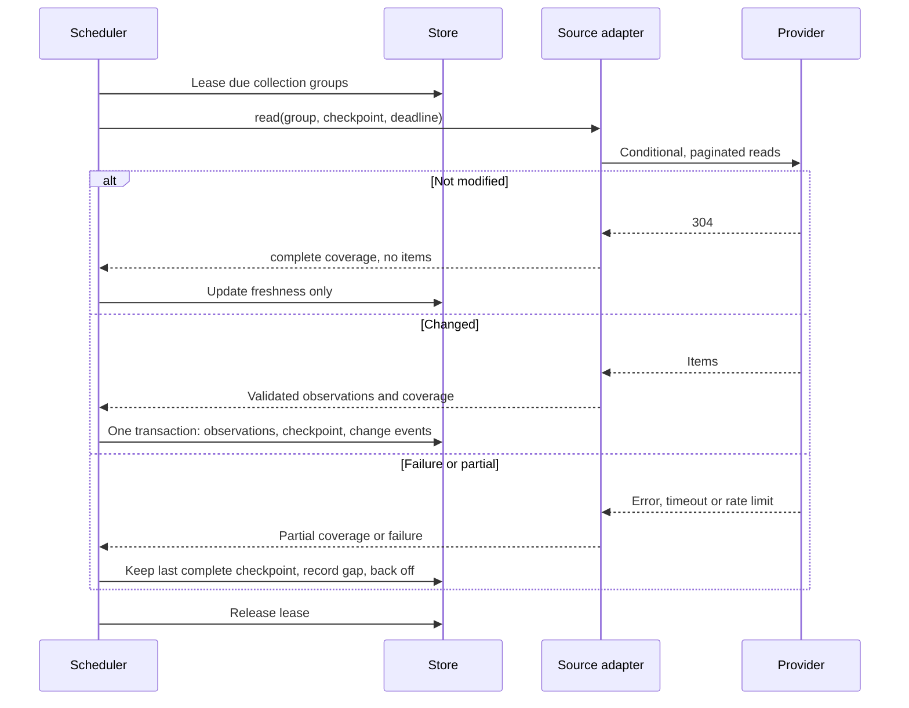
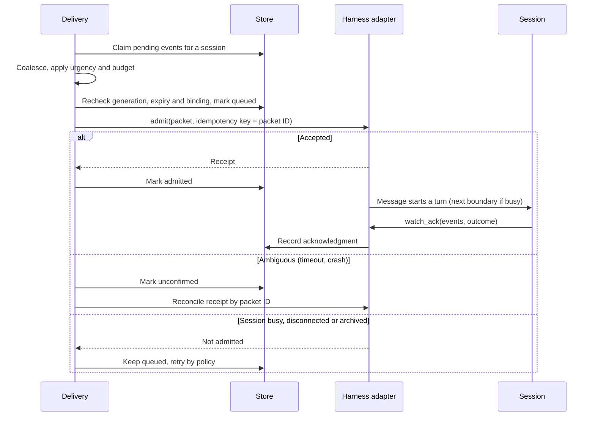
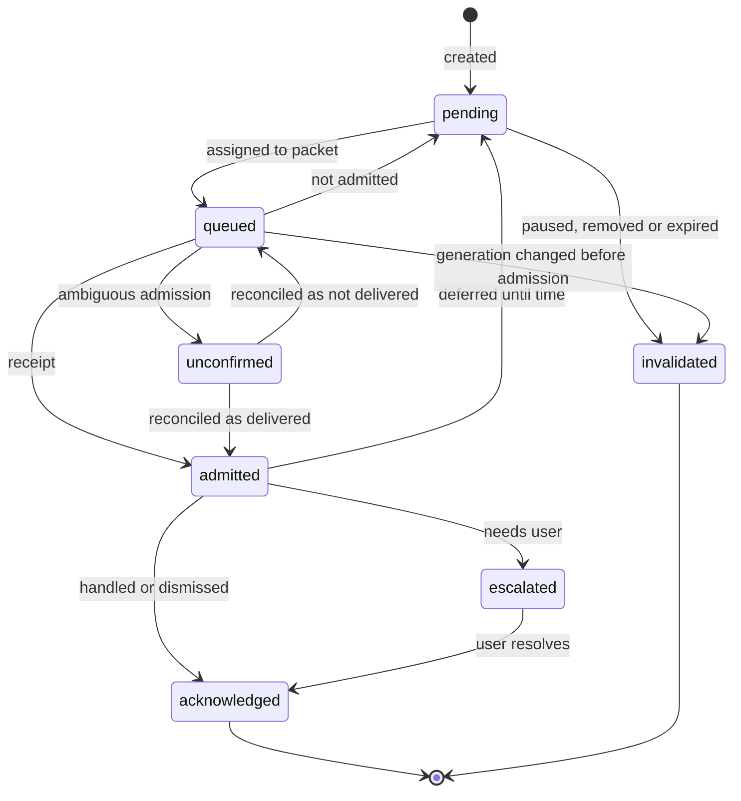
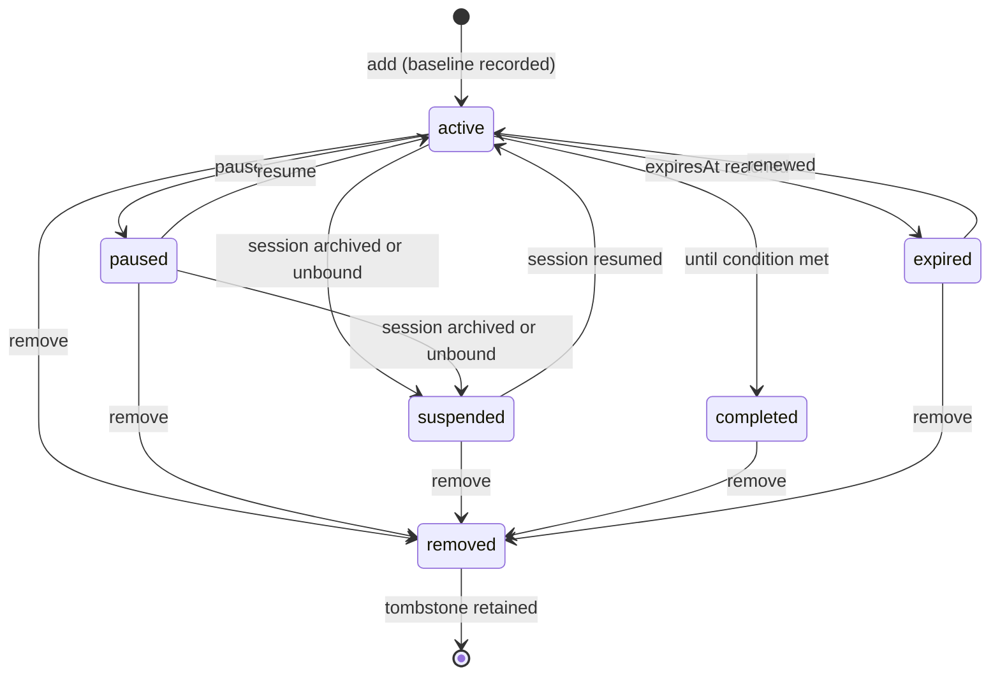
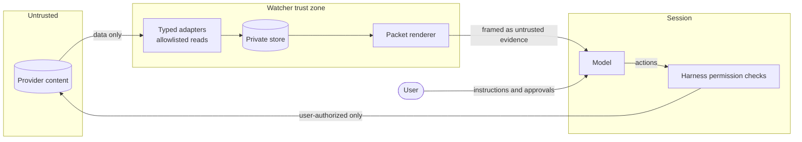

# Session source watcher architecture

**Status:** The first release implements the core, the daemon, the GitHub
pull-request source and the Copilot adapter as designed in
[watcher.md](design/watcher.md) and [copilot-plugin.md](design/copilot-plugin.md);
the rest of this document is the target architecture. The conversation-facing
contract is described in [session interaction](session-interaction.md).

## Purpose

Keep an AI conversation informed about the resources its work is waiting on,
while spending model tokens only when something meaningful changes. Polling,
event listening, change detection and summarization run in the watcher,
outside the model; unchanged checks never start a model turn.

The agent registers and clears subscriptions on its own as part of its work;
the user sees all of them and can change them. Each session owns its
subscriptions. A shared local service collects evidence, detects changes and
sends the owning session a message through its harness adapter. The session
interprets changes under its existing permissions.

### Non-goals

- A general workflow engine, rule language or autonomous remediation system.
- Implicit subscriptions: every subscription is a deliberate registration by
  the agent or the user. Mentioning or reading a resource never subscribes.
- A hosted service or a distributed broker.
- Exactly-once execution across the service and a conversation runtime.

## Terms

| Term | Meaning |
| --- | --- |
| Session binding | Provider-qualified identity of one conversation: harness, host, native session ID and account |
| Source | Typed canonical locator of a resource, such as `github.pull_request` plus URL |
| Subscription | One session's interest in one source: change categories, policy, origin, reason and generation |
| Collection group | Subscriptions whose reads can be shared because identity, account and access scope match |
| Observation | A validated item read from a source, with stable item ID, version and actor |
| Checkpoint | The latest complete or partial coverage of a collection group |
| Change event | An observation that matters to one subscription, with a stable event ID |
| Packet | A bounded set of change events delivered to one session |
| Acknowledgment | The session's assessment outcome for exact event IDs |

## System context

## Deployment

One supervised watcher daemon runs per user and machine. Several harnesses and
many sessions connect to it. The UI is a client of the same daemon, so opening
or closing a panel never starts or stops monitoring.

IPC uses a user-private Unix domain socket or named pipe. Clients prove
possession of a user-private secret in their first frame, and every
connection declares its role, which determines whether it acts with user or
agent authority. A localhost TCP port, if offered for a browser dashboard,
requires a token and an origin check. The
[watcher design](design/watcher.md#ipc-protocol) specifies the protocol.

## Components and modules

| Component | Responsibility |
| --- | --- |
| Core | Domain types, state machines, diffing, coalescing and packet rendering; no I/O |
| Store | Transactional registry, checkpoints, observations, outbox and audit log |
| Service | Scheduling, leases, provider budgets, collection and delivery |
| Source adapters | Locator validation, reads, item identity, versions, actors and coverage |
| Application API | The single entry point for agent tools, UI and MCP |
| Harness adapters | Session binding, delivery tier, admission receipts and write reports |
| UI | Watch list, coverage, pending updates, escalations and audit history |

Start with one TypeScript package with separated modules. Dependencies point
inwards; only `harness/*` imports harness SDKs, and only `sources/*` performs
provider I/O.

## Implementation language

Use TypeScript on Node.js for the core and service. The UI uses HTML/CSS and
compiled TypeScript. A harness requiring a JavaScript extension entrypoint can
load compiled modules from a thin wrapper.

Validate external API requests, persisted records, IPC messages and provider
responses at runtime with schemas shared by all entry points. Static types do
not validate external data.

## Data model

Subscription and session writes carry revisions. Every user- or agent-initiated
change is also written to an append-only audit log with its actor, so the UI can
show who added, changed or removed a watch.

## Sources and change detection

A source adapter declares the source types it handles, the change categories it
can report, its read model and its coverage semantics.

| Read model | Used for | Change detection |
| --- | --- | --- |
| Stream | Comments, replies, review threads, log lines | A monotonic cursor or `since` timestamp plus per-item IDs; new or edited items are changes |
| Snapshot | Status, labels, check results, build stage state | A normalized projection per item; a change is a field-level difference to the last complete snapshot |
| Query | Saved searches and discovery queries | The set of matching item IDs; entering or leaving the set is a change |

Rules for all adapters:

- Every observation has a stable item ID, a version (provider version, update
  time or content hash of a normalized projection) and an actor where the
  provider exposes one.
- Volatile fields such as relative timestamps, rendered HTML or ordering are
  excluded from projections, so they cannot cause spurious changes.
- Edits and deletions are changes of an existing item, not new items.
- A read reports `complete` or `partial` coverage per change category. Partial
  evidence can be delivered but never certifies that nothing else changed.
- Query results never become individual subscriptions automatically.

Initial registration records a baseline. Existing content is delivered only
when the registration explicitly asks for assessment.

## Collection

### Credentials and collection modes

| Mode | Reads through | Works while the session is disconnected | Use when |
| --- | --- | --- | --- |
| Direct | The watcher's own provider connection from the OS credential store or an explicit authorization | Yes | The user has authorized the watcher for that provider and account |
| Bridged | The harness's authenticated tools, via the adapter | No | The harness owns the only credential; collection pauses with a visible gap while disconnected |

The mode is part of the collection group key. Collection is shared between
subscriptions only when provider, account, access scope, connector and required
reads match. Evidence never crosses account boundaries because two URLs match.

### Scheduling and provider budgets

- Each subscription states a desired cadence; a collection group runs at the
  fastest cadence of its active members, bounded by provider minimums.
- Schedules are jittered so restarts and many watches do not align.
- Reads use conditional requests (`ETag`, `If-Modified-Since`) and cursors
  wherever providers support them; a "not modified" response is complete
  coverage at minimal cost.
- Each provider account has a request budget derived from its rate-limit
  headers. When the budget is low, the scheduler stretches cadences by
  urgency and records the reduced freshness instead of failing silently.
- Errors use exponential backoff per collection group. Authentication failures
  stop the group, mark it as needing the user, and do not retry in a loop.
- Optional push hints (provider webhooks, file system events) trigger an early
  read. A hint is never itself evidence; the read is.

### Collection cycle

A lease has an owner and expiry, so a crashed or sleeping worker cannot hold a
group forever, and two workers cannot commit the same read.

## Turning observations into change events

For each observation in a collection group, the service creates a change event
for each member subscription whose categories match, unless one of these
applies:

1. **Echo suppression.** The observation matches a write the session reported
   through its adapter or `watch_expect`. Matching uses item IDs or a
   correlation key, not the account, so the user's own manual actions with the
   same account still arrive. Account-based suppression is opt-in per watch.
2. **Filters.** The subscription excludes the category, actor or field.
3. **Generation.** The subscription was paused, removed or re-created after
   the observation's read started.

Suppressed observations are kept for coverage and audit. Each event gets an
urgency from the subscription policy:

| Urgency | Delivery |
| --- | --- |
| `immediate` | Sent as a message to the session right away, starting a turn |
| `batched` | Collected for a digest window, then sent as one message |
| `passive` | Recorded and visible in the UI and `watch_pending`, never wakes the session |

## Delivery

When the watcher observes a meaningful change, it sends a message into the
owning session through the harness adapter. The message starts a turn in that
exact conversation, so the agent reacts without anyone polling from inside the
session. A packet is the content of one such message.

### Packets

- At most one packet per session is outstanding. Later events accumulate for
  the next packet.
- A packet preserves distinct messages, reviews and decision-relevant
  transitions. Repeated snapshot changes to the same field collapse into
  first-to-last (`passed -> failed -> passed` stays visible as a flap).
- Packets are rendered deterministically within a size budget. Omitted events
  are counted and retrievable; truncation never hides a terminal transition.
- Packets are framed as untrusted external content and contain no
  instructions beyond how to acknowledge.

### Delivery cycle

### Change event states

An admitted event is never invalidated: the session may already be acting on
it. Pause, expiry and removal stop collection and unadmitted delivery for that
subscription only. They do not delete external resources, cancel admitted work
or affect other sessions' subscriptions.

An unconfirmed packet is not re-sent blindly. If the adapter cannot reconcile
receipts, the packet is shown as unconfirmed in the UI and offered again only
through `watch_pending` or an explicit user action, with the same event IDs so
the session can deduplicate.

## Subscription lifecycle

Health is separate from lifecycle: an active subscription is `fresh`, `stale`,
`degraded` (partial coverage), or `blocked` (needs user, for example after an
authentication failure).

Removal creates a tombstone with its actor. An agent cannot re-add a source the
user removed from that session; it can ask the user, who can re-add it. Periodic
refreshes and restarts never resurrect removed subscriptions.

## Guardrails for agent-created watches

- Each session has a quota of active agent-created watches and a total request
  budget; the UI shows usage.
- Agent-created watches carry a short reason shown to the user, and require an
  expiry within a policy maximum.
- Each source adapter defines a default completion condition (merged, closed,
  finished), so watches end on terminal source states without a model turn.
- Cadence has a provider-specific minimum.
- Agents can modify only their own session's watches. Users can modify all
  watches of the sessions they own.

## Reliability

- Private SQLite storage in WAL mode; observations, checkpoints and change
  events commit in one transaction (transactional outbox).
- Stable event and packet IDs; publication uses the packet ID as idempotency
  key, and sessions deduplicate by event ID.
- Delivery is at least once with reconciliation; ambiguous admission is
  reconciled, not retried blindly.
- After restart or sleep, the service performs bounded catch-up within actual
  provider retention. Unfillable gaps remain visible and never advance a
  checkpoint past lost evidence.
- Busy or disconnected sessions retain bounded pending work. When the bound is
  reached, the oldest batched and passive events are summarized as a gap, and
  immediate events and terminal transitions are kept.
- Archived sessions suspend collection and delivery until explicitly resumed.
  Unknown availability is not proof of a reachable session.
- The daemon is supervised independently of UI panels. A running daemon does
  not imply that bridged harness tools are available.

## Harness portability

Sending a message that starts a turn in the exact session is the target
delivery mode. Each adapter declares capabilities: delivery tier (message,
or the next-turn and pull fallbacks),
availability inspection, admission receipts and reconciliation, write
reporting, context updates, bridged tool execution and embedded UI.
Unsupported capabilities remain explicit and degrade to the next tier.

The portable MCP server supplies subscription management, `watch_pending` and
`watch_ack`. MCP resource notifications do not by themselves guarantee model
wakeups, persisted subscriptions or exact-session delivery.

Adapters are pluggable and packaged per harness; see
[harness integrations](integrations/README.md) for the adapter contract and
the [Copilot](integrations/copilot.md) and
[OpenChamber](integrations/openchamber.md) adapters.

An integration spike verifies a harness's publicly supported execution and
delivery contracts before implementation depends on them. Experimental APIs are
capability-gated and labelled; private APIs are not a portability contract.

## Security and trust

- Use existing credential stores or explicitly authorized provider
  connections. Never put secrets in manifests, observations, packets or logs.
- Authenticate every IPC client and verify session, host and account bindings.
  Localhost is not authentication.
- Adapters accept typed, validated locators and allowlisted reads, never
  arbitrary shell commands, URLs to fetch or executable subscription
  definitions. File sources are limited to user-approved paths.
- Source content is untrusted evidence. Incoming changes do not grant
  permission to post messages, modify resources, merge code, remediate systems
  or create other sessions.
- A session can see only its own subscriptions and packets.

## Privacy and retention

- Store normalized projections and evidence references rather than full
  content where a link suffices; keep full content only as long as it is
  needed for pending packets.
- Acknowledged evidence and audit entries expire by configurable retention.
- Removing a session binding deletes its packets and evidence after pending
  acknowledgments are closed.
- Keep examples and fixtures synthetic, and evidence outside repositories.

## Observability

The daemon exposes local, content-free metrics and a status view: reads by
provider and outcome, budget usage, freshness, coverage gaps, pending and
unconfirmed packets per session, and acknowledgment latency. Logs carry IDs,
not source content.

## First implementation gate

Prove one public pull-request subscription end to end: baseline, quiet
conditional polls, detection of a review and a check transition, echo
suppression of the session's own reply, exact-session admission and
acknowledgment. Exercise duplicate delivery, disconnect and reconnect, restart
after admission, rate limiting, incomplete reads, and concurrent pause and
remove.

Then add a second harness in a different delivery tier to test portability
before investing in many source adapters.

## Open questions

- Which harnesses publicly support sending a message into an exact session,
  with admission receipts, and which fall back to next-turn or pull delivery.
- Default digest window and update size budget, to be tuned with real usage.
- Whether push hints justify a local webhook receiver or remain limited to
  file system events at first.
