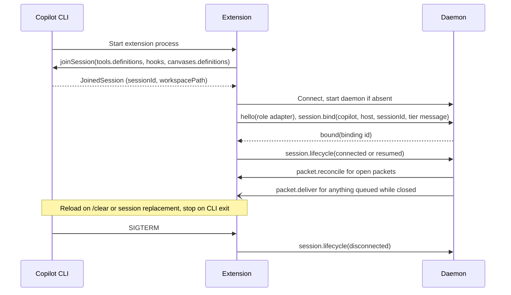
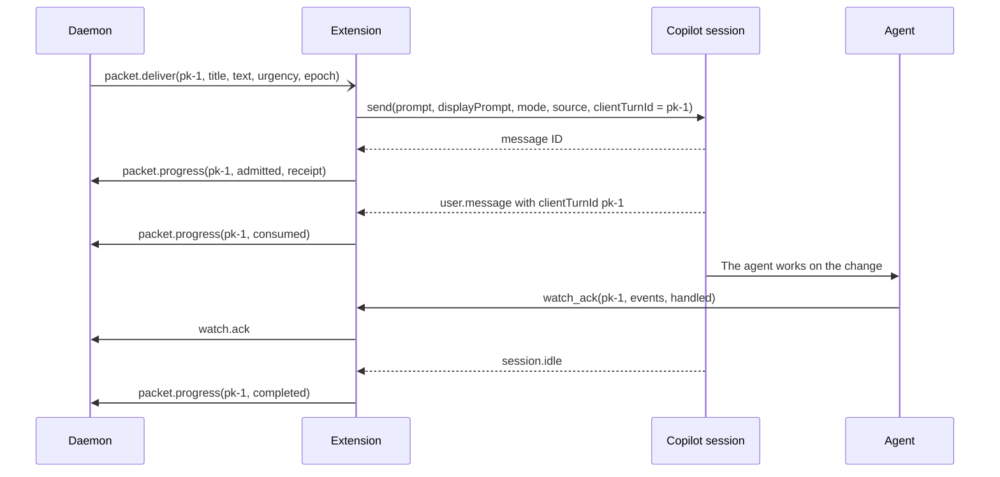

# Copilot plugin design

**Status:** Implemented in the first release and verified in a live Copilot CLI session. It refines
the [Copilot integration](../integrations/copilot.md) into a concrete
extension, built against the Copilot extension SDK type definitions and
documentation that ship with the Copilot CLI. The daemon side is designed in
[watcher.md](watcher.md).

## Responsibilities

The plugin is a thin adapter. It owns no watch state and performs no
collection.

| Responsibility | Mechanism |
| --- | --- |
| Join the session | `joinSession()` attaches the extension process to the session it was started for |
| Bind to the daemon | `session.bind` with `session.sessionId` |
| Watch tools | `joinSession({ tools })`, forwarded to the daemon; the list also carries `definitions` for SDKs that expect that shape |
| Teach the agent when to watch | `onSessionStart` returns `additionalContext` |
| Send change messages | `session.send` with an automation source and the packet ID as `clientTurnId` |
| Detect consumption | `user.message` events echo `clientTurnId` when the message is consumed |
| Detect completion | `session.idle`, or an `abort` of the top-level agent, after consumption |
| Reconcile after failures and restarts | `session.getEvents()`, matching `user.message` events by `clientTurnId` |
| Report own writes | `onPostToolUse`, for recognized mutating commands |
| Watch list for the user | A canvas whose page is served by the extension |

## Packaging

```text
dist/copilot-plugin/                    # built by npm run package:copilot
├── plugin.json
└── com.github.copilot/
    └── extensions/
        └── session-source-watcher/
            ├── extension.mjs           # esbuild bundle of src/adapters/copilot
            └── ssw.mjs                 # bundled command line; starts the daemon
```

- `extension.mjs` is a single ES module with all dependencies bundled. The SDK
  module, `@github/copilot-sdk/extension`, is resolved by the CLI and marked
  external in the bundle; the CLI resolves `@microsoft/copilot-sdk/extension`
  to the same module.
- `npm run install:copilot` copies the extension directory to
  `~/.copilot/extensions/session-source-watcher/` (or under `COPILOT_HOME`).
  During development the same directory can live in
  `.github/extensions/session-source-watcher/` of a repository.
- Copilot extensions are experimental: they load only when the CLI runs with
  `--experimental` or experimental features are turned on. In prompt mode
  (`copilot -p`), project extensions also need
  `GITHUB_COPILOT_PROMPT_MODE_EXTENSIONS=true` and an approved launch.
- The extension starts eagerly. It has no `extension.json` for request-driven
  activation, because event observers, hooks and background delivery must run
  without a tool call first.
- The extension starts the daemon with `node ssw.mjs daemon`. It uses its own
  `process.execPath` only when that is a `node` binary, because extensions can
  run under a runtime that is not; `SSW_DAEMON_COMMAND` overrides the command.
  The daemon's standard error goes to `daemon.stderr.log` in the state
  directory.
- The plugin does not request sensitive environment variables. The daemon,
  not the extension, reads provider credentials.

## Lifecycle



- **Host ID.** A stable random ID stored in the daemon's state directory
  identifies the machine. The binding key is `copilot`, host ID and
  `session.sessionId`.
- **Reconnects.** If the daemon connection drops, the extension reconnects
  with backoff and binds again. Binding is idempotent and starts a new
  connection epoch; the daemon reconciles every open packet of the binding
  before it assembles a new one, so a restart of either side is harmless.
- **Resume.** `onSessionStart` with source `resume` binds the same session
  again; packets that queued while the session was closed are delivered
  then, as one message per packet.
- **Replacement.** A new foreground session, for example after `/clear`, has
  a new session ID and therefore a new binding. Watches belong to the
  conversation that created them and are not moved implicitly; the old
  binding becomes `disconnected`, and the user can move or remove its watches
  in the watch list.
- **Shutdown.** `session.shutdown` and process termination report
  `disconnected`. Collection continues; packets wait.
- **Closed app sessions.** A Copilot app session that is not running has no
  extension process. Its packets queue and are delivered when the session is
  opened again. The daemon does not try to start sessions.

## Tools

Registered through `joinSession({ tools: { definitions: [...] } })`, the typed
shape in the SDK. Tool names must be unique across all loaded extensions; a
collision prevents the extension from loading, which `ssw doctor` reports.

| Tool | Arguments | Daemon method |
| --- | --- | --- |
| `watch_add` | `source`, `changes`, `policy`, `reason`, `baseline` | `watch.add` |
| `watch_list` | none | `watch.list` |
| `watch_update` | `watch`, `expectedRevision`, changes | `watch.update` |
| `watch_pause`, `watch_resume` | `watch`, `expectedRevision` | `watch.pause`, `watch.resume` |
| `watch_remove` | `watch`, `expectedRevision` | `watch.remove` |
| `watch_pending` | none | `watch.pending` |
| `watch_ack` | `packet`, `events`, `outcome`, `deferUntil`, `note` | `watch.ack` |
| `watch_expect` | `source`, `items` | `watch.expect` |

- The binding comes from the extension's connection, never from arguments.
  `invocation.sessionId` must equal the bound session ID; a mismatch fails the
  call.
- `watch_ack` requires `deferUntil` for the `deferred` outcome.
- Handlers return `{ textResultForLlm, resultType }`. Validation and daemon
  errors return `resultType: "failure"` with a short explanation, because a
  thrown error reaches the model only as a generic failure.
- Results are compact text, for example
  `Watching w-7: example/project#42 (reviews, checks, state) until merged.`

## Teaching the agent to watch

`onSessionStart` returns `additionalContext` with two parts:

1. A short, fixed guide: add a watch after opening or updating a pull request
   or starting something that will need follow-up; do not watch resources
   that were only read; give a reason; remove watches that are no longer
   needed; never re-add a watch the user removed; acknowledge every watcher
   message with `watch_ack`.
2. On resume, the current watches of this session in one line each.

This keeps watching automatic without a tool call to discover the rules.

## Delivering a change



The send call:

```js
const messageId = await session.send({
  prompt: packet.text,
  displayPrompt: packet.title,                 // "Watcher: 2 changes on example/project#42"
  mode: packet.urgency === "immediate" ? "immediate" : "enqueue",
  source: "automation-session-source-watcher", // starts work, carries no human authority
  clientTurnId: packet.id,                     // echoed on user.message when consumed
});
```

- **Admission.** `send` resolves once the runtime admitted the message and
  returns the submitted message's ID, which becomes the receipt. Admitted is
  not consumed: an enqueued message can wait behind other work.
- **Provenance.** The automation source marks the turn as sent on behalf of
  an automation the user configured, without human authority. That matches
  the rule that a change message is evidence, not an instruction.
- **Modes.** `enqueue` appends to the session's message queue. `immediate`
  interjects into a turn in progress; it is used only for immediate-urgency
  packets, so a watcher message steers running work only when the change is
  decision-relevant.
- **Consumption.** The runtime echoes `clientTurnId` on the `user.message`
  event when it consumes the message, whether it started a turn, drained
  from the queue or was taken as steering. The extension reports `consumed`
  on that event.
- **Completion.** The session going idle (`session.idle`), or an `abort` of
  the top-level agent, reports `completed` for every packet consumed before
  it and not yet completed; aborts of sub-agents do not count. A packet that
  steered a running turn therefore completes with that turn. `onAgentStop`
  is not used: it fires after every agent interaction, including each
  Autopilot continuation, while `session.idle` fires once, when the runtime
  has nothing left to do. Autopilot continuations repeat the packet's
  `clientTurnId` on a `user.message` with source `autopilot`; they are not a
  new consumption.
- **Completion is a release, not an assessment.** Another hook can block a
  stop and keep the agent working, so `completed` may arrive early. That only
  frees the session for the next packet: `watch_ack` is still accepted for
  events of a closed packet, and the next packet is queued behind the
  running work.

### Reconciliation

The daemon asks for reconciliation after an `unknown` result, after a
timeout, and for every open packet when the extension binds. The extension
reads `session.getEvents()`:

| Finding | Report |
| --- | --- |
| A `user.message` with `clientTurnId` equal to the packet ID | `consumed` |
| Consumed, and the session went idle after it, or the extension process was restarted since | `completed`; the turn that consumed it is over, possibly interrupted |
| Not consumed, the send returned a message ID | `admitted`; consumption is still expected |
| Not consumed, sent by an earlier extension process, and the history has a `session.resume` after the send | `not-admitted`; the runtime's pending queue did not survive the restart |
| Not consumed, otherwise | `unknown` |

The daemon passes the packet's send time with the request. The pending
message queue belongs to the runtime process and is not persisted: when the
runtime stops, queued messages are dropped without a `user.message`. A
`session.resume` after the send therefore proves that an unconsumed message
was lost, and the packet is sent again on the new connection. Without that
proof the adapter never reports `not-admitted`: the SDK offers no way to
inspect the pending queue or to fence a send that may still be in flight,
and an admitted message appears in the event history only once it is
consumed. An unknown packet stays unconfirmed until its consumption appears
or the daemon closes it as `unconfirmed` after ten minutes. The
`clientTurnId` is persisted with the event, so consumption is found after
the extension or the CLI restarted.

## Reporting own writes

`onPostToolUse` receives the tool name, arguments and result of each
successful tool call. The extension keeps the session's watched sources in
memory (refreshed after every watch change). It reports a write only when the
call is a recognized mutation of a watched source:

| Mutating call | Identifier taken from | Reported as |
| --- | --- | --- |
| Shell `gh pr comment` | Printed comment URL `...#issuecomment-{id}` | `comment:{id}` with version `{id}` |
| Shell `gh pr review` | Printed review URL `...#pullrequestreview-{id}` | `review:{id}` with version `{id}` |
| Shell `gh api` with `POST` or `PATCH` on a watched pull request's comments or reviews | Response `id` | matching item key with version `{id}` |
| Shell `git push` updating a watched head branch | `{old}..{new}  {branch} -> {branch}` | `head` with version `{new}` |
| GitHub MCP tools that create or update comments and reviews on a watched pull request | Result `id` and `html_url` | matching item key with version `{id}` |

URLs that merely appear in the output of read-only commands are ignored.
Writes are sent with `writes.report` and expire after ten minutes; tool output
content is never forwarded. A write the extension cannot recognize arrives as
a normal change, or the agent declares it with `watch_expect`.

## Watch list canvas

Canvases are an experimental SDK surface. The extension registers one through
`joinSession({ canvases: { definitions: [createCanvas({ id: "watch-list", ... })] } })`
when the host supports canvases, and otherwise points users to the daemon's
local dashboard. `open` starts a local HTTP server on `127.0.0.1` with a
random port and returns its URL; the page shows the session's watches, their
origin and reason, health, coverage, pending, unconfirmed and unacknowledged
messages, and removed watches.

- **User actions.** Pause, resume, remove and resolve buttons post to the
  extension's server, which forwards them to the daemon on a separate `ui`
  connection with user authority. Requests carry a per-instance token
  embedded in the page and must have a matching `Origin`.
- **Rendering.** The page renders every value as text through DOM text
  nodes, never as HTML, and sets a content security policy that allows only
  its own origin. Links are limited to `https` URLs on the watched source's
  host.
- **Agent actions.** The canvas exposes only `get_state` to the model. The
  agent changes watches through the watch tools, with agent authority.
- **Limits.** An agent with shell access could still fetch the page and use
  its token. As in the daemon, user authority is an attribution boundary; the
  harness's shell permissions are the control.
- Closing the panel stops its HTTP server; monitoring continues.

## Failure handling

| Situation | Behaviour |
| --- | --- |
| Daemon not running | Start it detached, retry for five seconds, then report `ssw doctor` guidance in tool results |
| Daemon connection lost | Reconnect with backoff and bind again; the new epoch fences late results; open packets are reconciled |
| `send` throws | `unknown`; resolved by reconciliation, never by a blind resend |
| Session busy | `enqueue` waits behind current work; `immediate` steers the running turn |
| Extension reloaded mid-delivery | The new process binds, and the daemon reconciles every open packet first |
| Acknowledgement before the admission report | Accepted; later progress reports cannot reopen the packet |
| Tool name collision | Extension fails to load; `ssw doctor` names the conflicting tool |
| Canvases unsupported | No panel; the local dashboard is offered |
| Protected Mode blocks the state directory | Binding fails with a clear tool result; the user must allow the path or run the daemon as a service |

## Verification checklist

`npm run test:live` runs the automatable checks in a real Copilot session
(CLI 1.0.118) driven through the Copilot SDK, with the packaged extension,
the bundled daemon, a scripted GitHub API and a fake `gh`. See
[CONTRIBUTING](../../CONTRIBUTING.md#live-copilot-checks).

| Check | Result |
| --- | --- |
| Extension loads, registers its tools, hooks and canvas | Verified |
| The daemon starts on demand from the extension and the session binds | Verified |
| `watch_add` and `watch_list` through the real tool runtime | Verified |
| A change detected while the agent is in a turn reaches that session as a watcher message | Verified: an `immediate` packet was delivered as steering into the running turn |
| The `user.message` event carries `source: automation-session-source-watcher` and the packet ID as `clientTurnId` | Verified in the persisted session history |
| Consumption is detected from the echoed `clientTurnId`; the agent's `watch_ack` closes the packet | Verified |
| `send` into an idle session starts a turn | Verified in the CLI (`test:live`, scenario `idle`) |
| `clientTurnId` for enqueued messages and after a restart | Verified (`idle`, `restart`) |
| Completion once per packet, after the last Autopilot continuation | Verified (`autopilot`): `onAgentStop` fires per interaction, `session.idle` once |
| `onPostToolUse` payload for the shell tool; the agent's own `gh pr comment` is suppressed | Verified (`writes`) |
| Runtime killed while a packet is queued, then the session resumed | Verified (`restart`): the queued message was lost with the runtime, sent again once and delivered exactly once |
| `onPostToolUse` payloads for GitHub MCP tools | Open, needs a real repository; extraction is unit-tested against the documented shapes |
| Starting the daemon from an extension process under Protected Mode | Open, manual |
| The same checks in the Copilot app | Open, manual |
