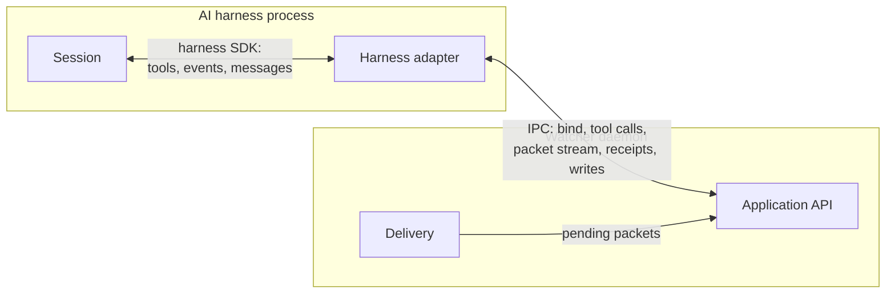

# Harness integrations

**Status:** Proposed. Interfaces are design targets, not an implemented API.

The watcher core knows nothing about any particular AI harness. Each harness
gets a small, separately packaged **adapter** that runs inside the harness and
talks to the watcher daemon over its authenticated local IPC. Adding a harness
means writing an adapter; the daemon, store and source adapters do not change.

| Harness | Page | Delivery tier |
| --- | --- | --- |
| GitHub Copilot (CLI and app) | [copilot.md](copilot.md) | Message |
| OpenChamber and OpenCode | [openchamber.md](openchamber.md) | Message, with idempotent delivery |
| Claude Code | [Claude Code channel](#claude-code-channel) | Message, while the channel research preview is available |
| Any MCP-capable harness | [Generic MCP](#generic-mcp-fallback) | Pull, or message where the harness can wake on process completion |

## Where an adapter sits



The adapter is the only code that imports a harness SDK. It translates in both
directions:

- **Session to watcher:** registers the watch tools in the harness, forwards
  their calls, reports the session's own writes and lifecycle changes.
- **Watcher to session:** receives packets for its bound session, turns each
  into a message in that conversation, and returns an admission result.

## Adapter contract

Every adapter implements the same responsibilities, expressed here as a
TypeScript sketch of the adapter side of the IPC protocol:

```ts
interface HarnessAdapter {
  /** Stable harness identifier, for example "copilot". */
  readonly harness: string;

  /** What this harness can do; unsupported features degrade explicitly. */
  capabilities(): AdapterCapabilities;

  /** Provider-qualified identity of the conversation this adapter runs in. */
  bind(): Promise<SessionBindingClaim>;

  /** Turn a packet into a message in the bound session. */
  deliver(packet: RenderedPacket, urgency: Urgency): Promise<AdmissionResult>;

  /** Report what the harness can prove about a packet, by packet ID. */
  reconcile?(packetId: string): Promise<PacketProgress>;

  /** Consumption and completion of delivered packets. */
  onProgress(listener: (packetId: string, progress: PacketProgress) => void): void;

  /** Writes the session performed, used for echo suppression. */
  onWrites?(listener: (writes: ObservedWrite[]) => void): void;

  /** connected, busy, idle, disconnected, archived. */
  onLifecycle(listener: (state: SessionLifecycle) => void): void;
}

interface AdapterCapabilities {
  tier: "message" | "next-turn" | "pull";
  admissionReceipts: boolean;
  reconciliation: boolean;
  writeReporting: "exact" | "best-effort" | "none";
  embeddedUi: boolean;
  bridgedReads: boolean;
}

type AdmissionResult =
  | { status: "admitted"; receipt: string }
  | { status: "not-admitted"; reason: "busy" | "disconnected" | "rejected" }
  | { status: "unknown"; reason: string };

type PacketProgress =
  | AdmissionResult
  | { status: "consumed" }                // the session took the message into a turn
  | { status: "completed" };              // the agent stopped after consuming it
```

Rules that every adapter follows:

- The session identity comes from the harness, never from a model-supplied
  argument. The daemon verifies the claim against the adapter's IPC token.
- `deliver` returns `unknown` rather than guessing when the harness gives no
  clear answer. The daemon then reconciles instead of retrying blindly.
- Admission, consumption and completion are reported separately. A harness
  queue can admit a message long before the agent consumes it, and only
  completion frees the session for the next packet.
- User-authority operations (removing a watch, resolving an escalation) come
  from the user interface channel. They are never exposed as actions the model
  can invoke on the user's behalf.
- Write reports carry only identifiers of resources the session already
  watches, never tool output content.
- An adapter that cannot do something declares it. The daemon and UI show the
  resulting tier instead of implying a capability that does not exist.

## Packaging

Adapters live under `adapters/<harness>/` in this repository and are built as
separate entrypoints from the same TypeScript package. A harness loads its
adapter the way it loads any other extension or plugin; the daemon does not
load adapters.

## Claude Code channel

A Claude Code channel is an MCP server spawned by one Claude Code session that
pushes `notifications/claude/channel` events into it, so the spawning session
is the exact target. Channels have no acknowledgement or replay, so the
adapter carries the packet and event IDs in the notification's `meta`,
exposes `watch_ack`, and sends unacknowledged packets again with the same IDs
after reconnecting. It never declares the permission-relay capability.
Channels require explicit enablement per session and, for organizations, an
allowlist; the adapter reports the pull tier when they are unavailable.

## Generic MCP fallback

Any harness that supports MCP servers can use the watcher without a dedicated
adapter:

- The MCP server exposes the watch tools, `watch_pending` and `watch_ack`, and
  binds to a session through a token issued when the server starts for that
  session.
- Changes arrive on the agent's next turn or when it calls `watch_pending`
  (pull tier).
- Harnesses that notify the session when a background process exits can reach
  the message tier with a waiter process; see
  [the Copilot page](copilot.md#without-an-extension) for the pattern.

MCP resource notifications alone do not wake a model or guarantee
exact-session delivery, so they are not used as the delivery mechanism.
