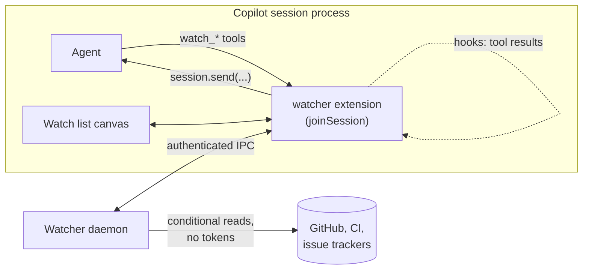
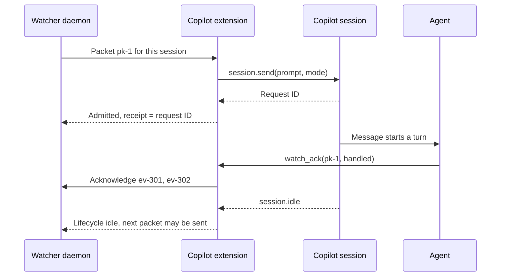

# GitHub Copilot integration

**Status:** Proposed. This page describes the planned adapter for GitHub
Copilot (Copilot CLI and the GitHub Copilot app). It is built only on the
public Copilot extension SDK (`@github/copilot-sdk/extension`). Verify the
current SDK reference before implementation; the code below is a sketch.

Copilot reaches the **message** tier: when the watcher observes a change, the
adapter sends a message into the exact conversation that owns the watch, and
that message starts a turn.

## How it fits together



One extension instance runs per Copilot session. The daemon runs on its own
and outlives every session, so watching continues while a conversation is
closed.

| Adapter responsibility | Copilot mechanism |
| --- | --- |
| Session binding | `joinSession()` joins the conversation that loaded the extension; `session.sessionId` is the native session ID |
| Watch tools for the agent | `tools: [...]` passed to `joinSession`, each handler forwarding to the daemon |
| Sending a change message | `session.send({ prompt, mode, displayPrompt })` |
| Admission receipt | The request ID returned by `session.send` |
| Lifecycle | `session.on(event)`: `session.start`, `session.resume`, `session.idle`, `session.shutdown` |
| Own-write reporting | `hooks.onPostToolUse`, matching tool results against watched resources |
| User controls | A canvas created with `createCanvas`, shown as a side panel in the Copilot app |

## Packaging

Ship the adapter as a Copilot plugin with an extension entrypoint:

```text
session-source-watcher-copilot/
├── plugin.json
└── com.github.copilot/
    └── extensions/
        └── session-source-watcher/
            ├── extension.mjs   # built from adapters/copilot
            └── ui.html         # watch list canvas
```

```json
{
  "name": "session-source-watcher",
  "description": "Session-owned watches; the watcher messages the session when something changes.",
  "version": "0.1.0",
  "extensions": { "com.github.copilot": {} }
}
```

For development, the same `extension.mjs` can live in a repository under
`.github/extensions/session-source-watcher/`, where Copilot loads it for
sessions in that repository.

The extension starts the daemon if it is not running and connects to it. It
never runs collection itself.

## The extension, sketched

```js
import { joinSession, createCanvas } from "@github/copilot-sdk/extension";
import { connectDaemon } from "./daemon-client.mjs";

let session;
const daemon = await connectDaemon();          // starts the daemon if needed

const forward = (name) => async (args) =>
  daemon.call(name, { binding: daemon.binding, args });

session = await joinSession({
  tools: [
    { name: "watch_add", description: "Watch a resource this session is waiting on.",
      parameters: watchAddSchema, handler: forward("watch_add") },
    { name: "watch_list", description: "List this session's watches.",
      parameters: { type: "object", properties: {} }, handler: forward("watch_list") },
    { name: "watch_ack", description: "Acknowledge exact events of a watcher message.",
      parameters: watchAckSchema, handler: forward("watch_ack") },
    // watch_update, watch_pause, watch_resume, watch_remove, watch_pending, watch_expect
  ],
  canvases: [watchListCanvas],
  hooks: {
    onPostToolUse: (input) => daemon.reportWrites(extractWatchedWrites(input)),
  },
});

daemon.binding = await daemon.bind({ harness: "copilot", nativeSessionId: session.sessionId });

session.on((event) => daemon.lifecycle(event.type));   // start, resume, idle, shutdown

// The watcher observed a change: send it into this conversation as a message.
daemon.onPacket(async (packet) => {
  try {
    const id = await session.send({
      prompt: packet.text,                                // framed as untrusted content
      displayPrompt: packet.title,                        // e.g. "Watcher: 2 changes on #42"
      mode: packet.urgency === "immediate" ? "immediate" : "enqueue",
    });
    return id ? { status: "admitted", receipt: id }
              : { status: "unknown", reason: "no request ID returned" };
  } catch (error) {
    return { status: "unknown", reason: String(error) };
  }
});
```

## Delivering a change



- **Send modes.** `immediate` urgency uses `mode: "immediate"`, which is
  admitted at the next turn boundary ahead of queued work. `batched` uses
  `mode: "enqueue"`, which waits behind work already pending. Neither mode
  interrupts a turn in progress.
- **One outstanding message.** The daemon sends the next packet only after the
  previous one was acknowledged, or after `session.idle` shows the turn ended.
  A turn that ended without `watch_ack` leaves the packet visible as
  unacknowledged; it is not sent again.
- **Ambiguous sends.** If `session.send` throws or returns no ID, the packet
  becomes unconfirmed. The adapter does not retry it. The watch list shows it,
  and the agent can retrieve it with `watch_pending`.
- **Display.** `displayPrompt` shows the user a short line such as
  "Watcher: 2 changes on example/project#42", while the full packet goes to the
  model.

## Session lifecycle

| Event | Adapter action |
| --- | --- |
| `session.start` | Bind and register tools |
| `session.resume` | Rebind with the same native session ID; the daemon sends any packets that queued while the session was closed |
| `session.idle` | Report idle; the daemon may send the next packet |
| `session.shutdown` | Report disconnected; collection continues, packets queue |
| Session archived in the app | Suspend the session's watches until it is resumed |

Because the daemon owns the state, closing Copilot loses nothing. When the
conversation is resumed, the extension reconnects and the session receives one
message summarizing everything that changed in the meantime.

## Recognizing the session's own writes

When the agent comments on a pull request or pushes a commit, the next read
would show that change. The adapter's `onPostToolUse` hook inspects completed
tool calls (for example `gh pr comment`, `git push` or GitHub MCP tools) and
extracts URLs, comment IDs and commit SHAs that belong to resources this
session watches. Those identifiers go to the daemon as expected writes, and the
matching observations are not sent back to the session.

This is best-effort: a tool that returns no identifiers cannot be matched. In
that case the agent calls `watch_expect`, or the change arrives as a normal
message. Hook inputs are untrusted; the adapter only extracts identifiers that
match watched resources, and never forwards tool output content.

## Watch list in the Copilot app

The extension registers a canvas that shows the session's watches, who added
them and why, coverage, pending and unacknowledged messages, and removed
watches.

- Pause, resume, remove and resolve buttons in the canvas UI call the daemon
  as **user** actions.
- Canvas actions that the agent could invoke are read-only, such as returning
  the current list. The agent changes watches only through the watch tools, as
  **agent** actions. This keeps the audit trail honest and keeps a removed
  watch from being re-added by the model.

Hosts that do not render canvases use the daemon's local web dashboard
instead.

## Credentials

The Copilot adapter uses **direct** collection: the daemon reads with its own
provider connection, for example the GitHub CLI's stored credentials or a token
in the OS credential store. Reads through Copilot's own tools (bridged
collection) are out of scope until there is a public contract for an extension
to execute them outside a model turn.

## Without an extension

Copilot CLI notifies a session when a background shell command it started
completes. That gives a message-tier fallback with no extension, using only the
MCP server:

1. The agent adds watches through the watcher's MCP tools.
2. The agent starts a waiter in the background:
   `session-source-watcher wait --binding <token>`. The waiter blocks without
   any model involvement and exits as soon as a packet is pending.
3. The process exit notifies the session, which starts a turn. The agent calls
   `watch_pending`, assesses the changes, calls `watch_ack`, and starts the
   waiter again.

The waiter costs no tokens while it waits. It needs the agent to restart it
after every message, and it stops with the session, so the extension remains
the preferred integration.

## Verification before relying on it

The first implementation gate for this adapter checks, against the then-current
SDK:

- `session.send` admission in idle, busy and resumed sessions, and the meaning
  of its returned ID.
- Behaviour of `immediate` and `enqueue` when several packets and user messages
  compete.
- Hook payloads available for write extraction from common GitHub tools.
- Extension restart and session resume without duplicate or lost packets.
