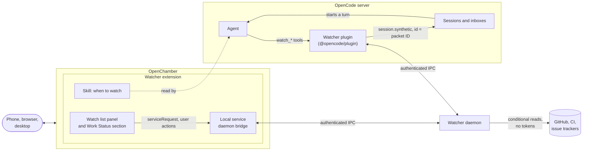
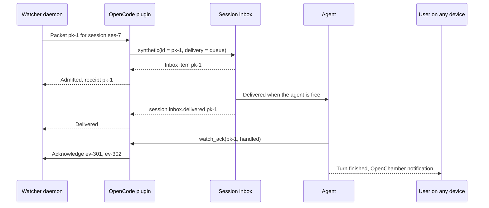

# OpenChamber integration

**Status:** Proposed. This page describes the planned adapter for
[OpenChamber](https://github.com/openchamber/openchamber), the open-source
workspace for [OpenCode](https://opencode.ai) on desktop, web and mobile. It
relies on the public OpenChamber extension API (`apiVersion: 1`,
`@openchamber/sdk`) and the OpenCode server plugin API (`@opencode/plugin`).
Verify both references before implementation; the code below is a sketch.

OpenChamber reaches the **message** tier with the strongest delivery
guarantees of any harness so far. The watcher adds an idempotent synthetic
message to the session's inbox, and OpenCode starts the agent with it.

## Why OpenChamber is a natural fit

- **Always-on server.** OpenChamber runs OpenCode as a long-lived server,
  often on a workstation you reach from your phone. Sessions keep existing
  while no window is open, so a watcher message can start work while you are
  away. The phone then gets OpenChamber's normal "session finished"
  notification.
- **Messages the user did not type.** OpenCode's synthetic messages are meant
  for notifications: the model reads them as user input, and the UI shows
  that the user did not type them.
- **Idempotent delivery.** A synthetic message takes a caller-chosen ID.
  Sending the same ID again returns the original item, so the packet ID makes
  retries safe and receipts exact.
- **One package.** An OpenChamber extension can ship a panel, a background
  service, sidebar marks, skills and an OpenCode plugin together, approved
  once by the user.

## How it fits together



| Adapter responsibility | OpenChamber or OpenCode mechanism |
| --- | --- |
| Session binding | OpenCode server identity (`GET /api/info`) plus the session ID from each tool call's `context.sessionID` |
| Watch tools for the agent | `ctx.tool.transform` in the plugin, in a `watch` namespace |
| Sending a change message | `ctx.session.synthetic({ sessionID, id, text, delivery })` |
| Admission receipt | The returned inbox item; `session.inbox.delivered` when the agent receives it |
| Reconciliation | Resend with the same `id`, or read `GET /api/session/{id}/inbox` |
| Busy or idle | `session.execution.*` events, or `GET /api/session/active` |
| Own-write reporting | `ctx.tool.hook("execute.after")` |
| Session archived or deleted | Extension session events `session-archived`, `session-deleted` |
| Teaching the agent when to watch | A skill shipped in `contributes.skills` |
| Current watch list in context | Session instruction entries (`ctx.session.instructions.entry`, experimental) |
| User controls | Extension panel, a Work Status section, sidebar marks |

## Packaging

One OpenChamber extension carries all OpenChamber parts:

```text
session-source-watcher-openchamber/
├── package.json        # manifest, "openchamber" block
├── panel/
│   ├── index.html      # watch list
│   └── main.js         # IIFE bundle using connectHost()
├── service/
│   └── main.js         # bridge to the shared watcher daemon
├── plugin/
│   └── index.js        # OpenCode server plugin: tools, hooks, delivery
└── skills/
    └── watching/SKILL.md
```

```json
{
  "name": "session-source-watcher-openchamber",
  "version": "0.1.0",
  "openchamber": {
    "apiVersion": 1,
    "id": "session-source-watcher",
    "name": "Watches",
    "icon": "eye",
    "contributes": {
      "panel": { "entry": "panel/index.html", "mobile": true },
      "service": { "entry": "service/main.js", "runtime": "host", "keepRunning": true },
      "sessionEvents": { "events": ["session-archived", "session-deleted"] },
      "opencodePlugin": "plugin",
      "skills": "skills",
      "marks": true
    }
  }
}
```

The user sees and approves these lines once:

- **Run a local service:** the daemon bridge.
- **Add a plugin to OpenCode:** the tools, hooks and message delivery.
- **Add to what agents read:** the watching skill.
- **Show marks in the sidebar:** pending and escalated watches.

The extension does not ask for `prompt`, `sessionControl` or conversation
content. Change messages are sent by the OpenCode plugin through the
synthetic-message API, and nothing reads the conversation.

## Where the daemon runs

The watcher daemon runs on the same machine as the OpenCode server. That is
the machine whose credentials it uses and whose sessions it messages, not the
phone or browser you look at it from.

The extension's service is a thin bridge. It starts the shared daemon if
needed and connects to it; it does not run collection itself. The daemon
outlives OpenChamber and serves other harnesses on the machine too, such as
Copilot. With OpenChamber's CLI started at login (`openchamber startup
enable`), watching and delivery continue while no device is connected.

## The OpenCode plugin, sketched

```js
// plugin/index.js: loaded by OpenCode with a bare import(); bundle the
// daemon client in, because nothing is installed next to this file.
import { connectDaemon } from "./daemon-client.js";

export default {
  id: "session-source-watcher",
  async setup(ctx) {
    const daemon = await connectDaemon({ harness: "openchamber", server: ctx.app });

    await ctx.tool.transform((editor) => {
      editor.namespace({ name: "watch", description: "Session-owned watches" });
      for (const tool of daemon.toolDefinitions()) {   // add, list, update, pause,
        editor.add({                                   // resume, remove, pending,
          ...tool,                                     // ack, expect
          options: { namespace: "watch" },
          // The owner comes from the calling session, never from the input.
          execute: async (input, context) => ({
            content: await daemon.call(tool.name, { sessionID: context.sessionID, input }),
          }),
        });
      }
    });

    // Own writes: identifiers of watched resources only, never tool output.
    await ctx.tool.hook("execute.after", (event) => {
      if (event.status === "completed") daemon.reportWrites(event);
    });

    // The watcher observed a change: send it into the owning session.
    daemon.onPacket(async (packet) => {
      const item = await ctx.session.synthetic({
        sessionID: packet.sessionID,
        id: packet.inboxID,          // derived from the packet ID: retries are safe
        text: packet.text,           // framed as untrusted content
        description: packet.title,   // for example "Watcher: 2 changes on #42"
        delivery: packet.urgency === "immediate" ? "steer" : "queue",
      });
      return { status: "admitted", receipt: item.id };
    });

    const controller = new AbortController();
    void (async () => {
      for await (const event of ctx.event.subscribe({
        types: ["session.inbox.delivered"], signal: controller.signal,
      })) daemon.delivered(event.data.sessionID, event.data.inboxID);
    })();

    return () => { controller.abort(); daemon.close(); };
  },
};
```

## Delivering a change



- **Delivery modes.** `queue` waits until the agent finishes its current work,
  so a watcher message never cuts into a running task. `steer` delivers
  before the agent's next model call, even mid-work. Only `immediate`
  urgency uses `steer`, and only for decision-relevant changes such as a
  failed check on the branch the agent is working on. Batched changes always
  use `queue`.
- **Exact receipts.** The inbox item ID is the packet ID. A crash between
  sending and recording the receipt is resolved by sending again with the
  same ID, which returns the original item instead of a duplicate.
- **Delivered versus admitted.** The daemon distinguishes an item waiting in
  the inbox from one the agent received (`session.inbox.delivered`). A
  queued item the user cancels from the inbox
  (`session.inbox.cancelled`) is recorded as not delivered and stays visible
  in the watch list.
- **One outstanding message.** As with every harness, the daemon sends the
  next packet only after the previous one is acknowledged or the turn that
  received it ended.

## Archived sessions

Sending a prompt to an archived OpenCode session unarchives it. The watcher
must not revive sessions on its own: on `session-archived` the daemon
suspends that session's watches, and it never sends packets to an archived
session. Resuming the session in OpenChamber resumes its watches.
`session-deleted` removes the session binding and its watches.

## Teaching the agent to watch

The extension ships a skill that every agent can read. It describes when to
add a watch (after opening a pull request, triggering a build, asking a
question in a thread), when to clear one, and that the user's removals are
final. That is how watching becomes automatic: the user asks for the work,
and the agent decides to watch what that work now waits on.

Where available, the plugin also keeps a short instruction entry per session,
for example `<context key="watches">w-7 PR example/project#42, until
merged</context>`. The agent always knows what it is waiting for without a
`watch_list` call, and updating the entry does not start a turn.

## In the OpenChamber UI

| Place | Shows |
| --- | --- |
| Panel on the rail | The session's watches: source, who added it and why, coverage, pending and unacknowledged messages, removed watches |
| Work Status section | Compact count of active watches and pending changes for the open session |
| Sidebar marks | An icon on sessions with an escalated or unconfirmed watcher message, and on branches whose watched checks fail |
| Chat | Watcher messages marked as not typed by the user, with their short description |
| Phone | The panel as its own workspace tab (`panel.mobile`) and the marks; notifications follow OpenChamber's settings |

User actions in the panel (pause, resume, remove, resolve an escalation) go
through `serviceRequest` to the bridge service and reach the daemon as
**user** actions. The agent can reach the watcher only through the plugin's
tools, as **agent** actions, so a watch the user removed cannot be re-added
by the model.

## Credentials

Collection is **direct**: the daemon uses its own provider connections on the
server machine, for example the GitHub CLI's stored credentials there. Using
the credentials OpenChamber holds for its integrations is out of scope; the
extension API keeps those tokens inside OpenChamber by design.

## Where it does not run

- **VS Code.** OpenChamber's VS Code extension loads no OpenChamber
  extensions and uses your own OpenCode CLI. Adding the plugin folder to the
  global OpenCode config gives the tools and message delivery there, without
  the panel; use the daemon's local dashboard instead.
- **Isolated spaces.** A session in an isolated space runs its own OpenCode,
  which does not load the plugin.
- **External OpenCode servers.** When OpenChamber did not start the OpenCode
  it talks to, the plugin must be added to that server's global config, and
  that server must run on the daemon's machine.

The same plugin works in plain OpenCode (TUI or `opencode serve`) when listed
in the global OpenCode config, with the same message-tier delivery.

## Verification before relying on it

- `ctx.session.synthetic` from a plugin instance for sessions in other
  locations of the same server, or one binding per location.
- Whether a synthetic message unarchives an archived session, as a prompt
  does.
- `queue` and `steer` behaviour when user prompts, Session Goals steps and
  watcher messages compete.
- Interplay with Session Goals: a goal session waiting on a watched pull
  request should end its turn and be resumed by the watcher, not keep polling.
- `execute.after` payloads available for write extraction from `bash`
  (`gh`, `git push`) and GitHub MCP tools.
- Plugin reload and OpenCode restart without duplicate or lost packets.
